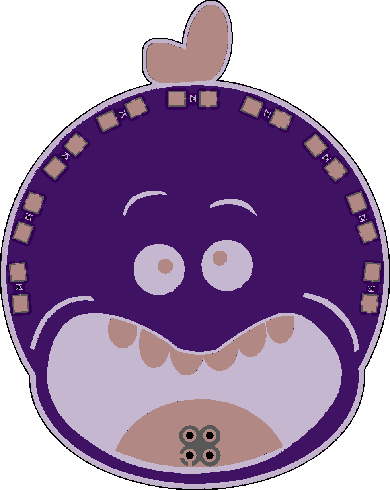

# Mr MeeSeeks Shitty Addon

A #badgelife shitty addon PCB designed for DEF CON 26.

Created by @d4rkwyng and SparX. Thanks to [AND!XOR](https://www.andnxor.com/) for their instructional video on the schematics used in this project.

## Preview

| Front | Back |
|:-:|:-:|
|  |  |

## Bill of Materials

Rev E (see `mrmeeseeks_RevE_BOM.csv`). Rev A–D boards carry a ninth LED/resistor pair (D9/R9) and an 0402 C1.

| Ref | Component | Package | Qty |
|-----|-----------|---------|-----|
| U1 | MCP23017 | SOIC-28 (`mrmeeseeks_RevE`) or SSOP-28 (`mrmeeseeks_RevE_ESO`) | 1 |
| D1-D8 | LED | 1206 | 8 |
| R1-R8 | 220 ohm | 1206 | 8 |
| C1 | 0.1uF | 1206 | 1 |
| X1 | Shitty connector | 2x2 | 1 |

## Revisions

- **Rev E** — Final revision, two board variants sharing `mrmeeseeks_RevE.sch`:
  - `mrmeeseeks_RevE.kicad_pcb` — MCP23017 in SOIC-28 (`MCP23017-ESO_NoSilk`, 1.27 mm pitch)
  - `mrmeeseeks_RevE_ESO.kicad_pcb` — MCP23017 in **SSOP-28** (`MCP23017-ESS_NoSilk`, 0.65 mm pitch), despite the "ESO" in the filename
- **Rev D** — PCB only (no schematic in repo); gerbers in `gerbers/mrmeeseeks_RevD.zip`
- **Rev B, Rev C** — PCB only
- **Rev A** — Initial prototype (schematic `mrmeeseeks_RevA.sch` + PCB)

## Project Structure

```
mrmeeseeks-addon/
├── design/          # Artwork, silkscreen, and soldermask KiCad footprints
├── gerbers/         # Manufacturing files (Rev D, Rev E, Rev E SSOP variant)
├── lib/             # KiCad component libraries
└── mrmeeseeks_*     # Schematic, PCB, and netlist files
```

## Tools

- [KiCad](https://www.kicad.org/) — Schematic and PCB design

## License

MIT License. See [LICENSE](LICENSE) file.
